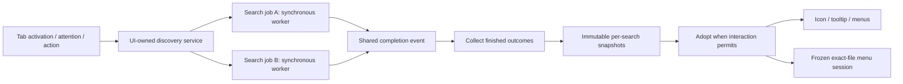

# General target versions: discovery, interaction, and verification

**Design revision:** 2026-10-19, reviewed design with implementation checkpoints.

**Scope:** Długosz Launcher on Windows 10/11, native x64.

**Implementation baseline:** `6b8288f` (general wildcard targets), with the missing
per-version context menu recorded in `30dbcbb`. This document records the
delivered scanner, service, runtime, presentation, overlay, menus and isolated
scenario controls, together with their design rationale and verification limits.

**Initial page/runtime checkpoint (`e9d891c`), 2026-10-19:** the generic scanner foundation,
UI-independent search service and production page integration are implemented.
Native worker ownership, completion through a shared manual-reset Event, safe
interaction adoption and activation-scoped requests replace the old mixed cache
and its two version timers. At that checkpoint the artwork, exact-file row
menus, broader budgets and optional scenario build were separate work; the
completion checkpoint below supersedes that historical scope. The numbered
sections retain the design rationale and acceptance requirements.

**Completion-queue checkpoint, 2026-10-19:** concrete preparation, labels, native
icon imports and cached menu capability facts now run in bounded workers. The UI
adopts owned BGRA data with each icon's action, text and immutable catalog;
interfaces remain in their owning COM apartment. Four active preparation jobs
and 64 MiB of admitted output pixels are allowed. The decoded page and inactive
result cache are also limited; WIC/D2D copies, decoder internals and allocator
overhead are additional, so this is not a hard process working-set bound.
Explicit Windows Shell submenus initialize lazily in the UI apartment.

Adobe now supplies detailed complete/incomplete/failed observations through the
same production service policy as generic targets. Both scanners enforce finite
component, work, entry, branch, distinct-target, metadata, translation and
accounted-storage budgets. Exhaustion is Incomplete, never a truncated Complete
catalog. Accounted storage covers retained string/container capacity and native
version buffers; bounded normalization/sorting scratch and allocator overhead
are additional. Default bounds are recorded in `TargetScanLimits`. Duplicate
Adobe layouts do not spend target allowance or read metadata twice.

Focused Release verification passed 94 scanner/Adobe/service cases (1,316
assertions), nine worker presentation cases (110 assertions), and isolated
Drawing, Adobe and generic-version native smoke checks. Evidence is retained in
`build/verification/2026-10-19-version-feature-completion`. Provisional SVG blinds
are integrated: rendering tests and actual icon composites verify transparent
gaps, attention-only visibility and unchanged pixels after completion. Presentation
data refreshes once per shown visit, preserving unchanged bitmaps. Exact row
menus and bounded pagination pass 56 actual native mouse/keyboard checks, with
six captured actions. A separate probe verified actual Properties and Explorer
selection. Both normal and isolated instrumented applications build. The scenario
controller passes five cases (78 assertions), all six local full-application
lifecycle/action scenarios pass, and three controlled SMB cases pass with remote
fixture cleanup. SMB operations are real; the held-provider delays are injected.
Normal-build exclusion and instrumented-install rejection are verified. Final
clean committed desktop acceptance is recorded in the evidence root's
`acceptance.json`; delivery requires that record to report success.

Reading guide:

- Behavior: [configuration and ordering](#2-configuration-and-discovery-semantics),
  [states and actions](#8-user-visible-states-and-interaction-snapshots),
  [overlay](#9-pending-artwork-static-embedded-svg-blinds),
  [version context menus](#10-exact-file-context-menus-for-individual-versions).
- Architecture: [ownership](#3-proposed-components-and-data-ownership),
  [activation](#4-activation-and-request-policy),
  [workers and shutdown](#5-workers-limits-and-cancellation),
  [completion](#6-completion-without-a-polling-timer),
  [error policy](#7-error-policy-and-snapshot-trust).
- Verification: [idle evidence](#11-idle-behavior-and-the-observed-thread-activity),
  [tests and fault injection](#12-testing-architecture-and-fault-injection),
  [special build](#13-optional-instrumented-build-for-visual-and-fault-scenarios),
  [acceptance](#14-diagnostics-and-acceptance-evidence).
- Delivery: [stages](#15-implementation-sequence-and-change-boundaries),
  [tradeoffs](#16-tradeoffs-and-questions-reserved-for-collaboration),
  [source map and review](#17-source-map-and-review-record).

### Delivered scanner foundation

[target_version_scan.hpp](../include/launcher/target_version_scan.hpp) adds a
synchronous detailed entry point and a worker-owned `TargetVersionSource`:

- `probe` reports a directory, regular file, other object, or native error.
- `enumerate` returns an owned cursor whose steps distinguish entry, normal end,
  and error. The native cursor owns and closes its FindFirst/Next handle.
- `read_metadata` returns present metadata, an empty optional for absent/invalid
  resources, or an error for unreadable metadata.

`scan_target_versions_detailed` returns `complete`, `incomplete`, or `failed`,
observed versions, and operation/path/error diagnostics. Complete may be empty.
Normalization/anchor failures are Failed; a later coverage or read error is
Incomplete even when no entries were observed. Partial entries remain evidence,
not an authoritative default. Allocation/adapter exceptions still propagate to
the existing background worker's exception boundary. Diagnostics retain the
first 64 failures and count additional omitted records.

The existing `scan_target_versions(path)` signature stays usable through an
adapter. It returns only Complete catalogs; otherwise it throws a contextual
`filesystem_error`, handled by legacy cache clients and standalone launch
preparation. Production pages use the detailed scanner through the per-search
service, so a generic failure preserves only that search's previous complete
catalog rather than blocking unrelated successful searches. A Complete empty
result retains its ordinary meaning and can replace old entries.

The native implementation in
[target_version_source.cpp](../src/target_version_source.cpp) preserves raw Windows
error distinctions. MSVC maps some network/invalid-name failures to generic
ENOENT; these must not be accepted as missing descendants. Final files/links
are followed with query-only native handles instead of a standard-library status
operation that can erase those errors. UNC share roots have a native handle
probe. Deliberate intermediate links and native wildcard grammar remain supported.

The native version APIs can report `ERROR_RESOURCE_DATA_NOT_FOUND` for an
exclusively locked executable containing a valid This resource. A retained read-access
handle exposes that sharing/access failure before querying version resources.
It shares reads/writes/deletes with installers; it is not an atomic file snapshot.
The handle establishes initial access/sharing, not a guarantee that Windows
reports every later provider failure accurately. Absent and invalid resources
are grouped without separate malformed-resource diagnostics in this first API.
The optional `read_target_version` wrapper retains metadata-reader compatibility.
Adobe's fixed-layout scanner now also returns structured coverage errors through
`scan_adobe_cc_detailed`, and its legacy wrapper rejects partial observations.

[target_version_scan_tests.cpp](../tests/target_version_scan_tests.cpp) supplies
scripted probes, cursors, metadata and gated delays to the production traversal.
It also uses owned real Windows files/resources/links and an exclusive lock.
These controls live in test code, with no production scenario switch, IPC, or
personal configuration changes. Branch/resource/aggregate scanner budgets are
now delivered. The separate opt-in scenario binary uses the same injection seams
without adding runtime controls to ordinary builds; see section 13 and
[the scenario guide](../tests/version-scenarios.md).

### Delivered search-service core

[version_discovery.hpp](../include/launcher/version_discovery.hpp) and
[version_discovery.cpp](../src/version_discovery.cpp) provide `VersionDiscoveryService`:

- Configuration retains search keys independently of the currently visible set.
  `begin_activation` gives a shown-tab visit its token and requests its distinct
  visible keys. Hidden/unconfigured keys and stale tokens cannot start work.
  `set_visible_searches` updates shown bindings after reload without beginning
  another activation or starting scans.
- Repeated requests join queued/running work or reuse the visit's completed
  attempt, including start/scanner failures. A new visit can retry. Dropping
  never-started queued work clears its reservation. Removed running searches
  remain registered until collection, so removing/readding a key cannot duplicate
  its job or forget its capacity.
- Each key retains an immutable last complete snapshot and a separate last
  attempt. Incomplete/failed observations retain the previous snapshot; a
  complete empty result replaces it with known-empty. Snapshot handles survive
  later collection and key removal. Ready searches can publish independently.
- Default admission permits 16 active jobs. Activation work starts only when the
  total active count is below 12, including any active attention jobs; attention
  can use all 16 slots and promotes queued work. Hidden speculative work is
  dropped when visibility changes. An explicit pending launch pins its queued
  search through hiding/tab changes until that intent completes or is canceled.
  Limits are injectable for focused tests.

The caller/provider adapter must supply canonical owned `VersionSearchKey`
locations and semantics. The service performs no filesystem canonicalization;
launch settings, item identity and activation are not key fields. Adobe has a
separate typed key, not a new Adobe scanner or improved Adobe error policy.

The scanner callable and externally owned `VersionDiscoveryExecutor` are injected.
The executor must either accept work exactly once or throw before accepting it;
it must outlive the service, and inline execution is allowed. Jobs own their
captures and publish through shared job state. All service methods run on one
owner thread. `collect_ready` collects ready outcomes without waiting, then admits
eligible queued work. Visibility transitions can collect without first admitting
an obsolete tab's queue. `retain_pending`/`release_pending` pair the lifetime of
explicit launch intents with work already queued or running; they do not retry
a terminal attempt. [version_discovery_tests.cpp](../tests/version_discovery_tests.cpp) uses a
manual executor for controlled ordering/start failure and gates around real
threads for publication/lifetime checks. Current verification is recorded below.

The service core chooses no Windows notification mechanism. Destroying it does
not wait for accepted work or make process exit safe; the native runtime below
owns that boundary.

### Delivered page/runtime integration

Production pages now use per-key service state for icons, labels, tooltips,
version menus and launch selection. Revealing the panel or selecting a different
shown tab begins a visit. Selecting a tab while collapsed changes the selected
page without starting its searches. Repeated hover, click and menu requests join
the current visit's work or use its completed attempt, including failures.
Initial hidden pages are not scanned. No periodic rescan or readiness timer
remains for version discovery.

The native executor in
[version_discovery_runtime.hpp](../include/launcher/version_discovery_runtime.hpp)
and [version_discovery_runtime.cpp](../src/version_discovery_runtime.cpp) owns
transient `std::thread` instances and their real exit observation handles.
Workers capture owned scanner inputs and publication data,
never the Window. They publish their result before signaling a shared manual-reset
Event. The outer message loop waits for both that Event and incoming Windows
messages, resets the Event before collecting ready jobs, and admits queued work
without waiting for a slow sibling. A modal menu may defer the drain until it
returns; no posted-pointer message or fallback polling timer is required.

Collection and presentation adoption are distinct. Completion can update the
service while an icon is pressed or another interaction is active, but changing
icons, descriptions and frozen menu rows waits until the interaction ends.
Unchanged catalogs retain drawing resources. A cold launch intent owns its
original item, options and label, follows only its search's outcome, and ends on
both success and failure. A failed initial check is distinct from a successful
empty catalog; retained complete data remains usable after a later failed check.

`NativeVersionDiscoveryExecutor::reset_completion` runs before the service drain.
`reap_exited` joins only workers observed to have exited, rather than treating
result publication as thread exit. Final close/restart cleanup uses the explicit
worker-lifetime boundary in section 5: `finish_process_if_busy` stops admission,
reaps exited workers and returns if the registry is empty. If work remains after
explicit application cleanup, self-`TerminateProcess` avoids ordinary CRT/static
teardown beneath the outstanding discovery worker. The runtime destructor
requires an empty registry and never waits or detaches implicitly.
Kernel/provider delays remain outside a bounded process-reaping promise.

The isolated native fixture in
[target-versions-smoke.ps1](../tests/target-versions-smoke.ps1) contains independent
program/document/no-match searches, a real exclusively locked executable, and
two pages sharing one pattern with different launch options. It verifies native
activation/completion evidence, cold failure status, menus and preserved action
options without executing configured programs or touching personal settings.
Injected runtime tests hold and release work deterministically for ordering and
lifetime coverage. The optional UI scenario build now supplies controlled gates
inside native directory cursors and metadata operations, with explicit fixture
inputs and captured dispatch.

Stage C now stages concrete preparation, Shell/icon imports and file/menu facts
in registered workers. Only owned action/text/pixel data crosses apartments;
the UI creates its own WIC/D2D objects and retains coherent per-icon catalogs.
Fresh visits refresh presentation data without polling, preserving unchanged
bitmaps. Exact version rows use pure lexical preparation, and explicitly opened
Windows commands retain native UI-apartment ownership. Shell extension work in
that explicit submenu can still block; ordinary Open/Admin/Reveal does not first
enumerate extensions.

### Initial integration verification (`e9d891c`), 2026-10-19

The Release build passed. The focused service/runtime/scanner/catalog/cache
group passed **87 cases, 1,127 assertions**, and the Adobe/restart API group passed
**10 cases, 132 assertions**. This includes controlled worker publication,
pending-intent scheduling, independent progress while a sibling is held, and
runtime child-process normal/blocked-worker/emergency shutdown checks. A
deterministic transition-race test publishes success or failure between the
pre-transition drain and activation, proving an original cold intent cannot
follow a replacement attempt.
The child fixtures verify the runtime process gate and explicit cleanup markers.
At this initial checkpoint they did not drive actual Window/logger teardown with
a blocked provider and fatal UI exception. The completed full-application runner
now covers those paths, including restart, through the real cleanup boundary.

Four native checks passed: isolated drawing/rendering, Adobe discovery, general
wildcard versions, and `RestartHandoffNative` with its three restart-process
scenarios. The general fixture verified successful and empty
searches alongside a real metadata sharing violation (`ERROR_SHARING_VIOLATION`,
32), hidden/revealed page activation, repeated-attention deduplication, native
menu/mouse-press adoption holds, retained original launch options and unchanged
drawing resources. Configured programs were not executed and personal settings
were not substituted. These initial checks used local files and controlled held
workers. Later completion-queue checks add real SMB discovery, locked-metadata
failure, injected coverage errors and controlled delays; they do not claim a
naturally stalled or broken NAS. A separate live icon launch used a copied GUI probe and verified the
real executor/Event completion path, exact target, quoted Unicode and empty
arguments, working directory, hidden show mode, and normal close. That isolated
fixture executed only its own probe and left the normal installed dock running.

## 1. Product intent and settled requirements

A versioned icon represents a family of concrete files. A normal click opens the
newest known member; its version list makes every other discovered member easy
to run, locate, and inspect. Configuring this should be as simple as replacing
the changing part of an ordinary path with native Windows wildcards.

This is a defining Launcher feature. Its quality depends as much on trustworthy
selection, quiet idle behavior, and useful failure handling as on finding files.
The user should never need to understand a cache or a worker thread to use it.

| ID | Requirement | Baseline and intended change |
| --- | --- | --- |
| R1 | Ordinary filesystem targets support versions, including documents and shortcuts. | Implemented; preserve and harden native matching. |
| R2 | Metadata determines executable versions; matched names give useful fallback labels. | Implemented; preserve documented ordering and make errors distinguishable. |
| R3 | Check the shown tab when the panel reveals or the selected tab changes. | Replace startup-wide and minute-wide refreshes with activation-scoped requests. |
| R4 | All triggers may request work; the service deduplicates it. | Track attempts per search and activation, including failures. |
| R5 | A slow or unavailable target does not serialize ordinary local discoveries. | Independent jobs and independent publication replace the global scan. See capacity limits in section 5. |
| R6 | Existing results remain usable while checking. | Keep complete snapshots and pin each action to its concrete file. |
| R7 | Only an attended icon shows that its own check is pending. | Add a static SVG blinds overlay; no animation or repaint timer. |
| R8 | Right-clicking a version offers the same useful file actions as the icon. | Missing; add an exact-file child context menu, including Properties. |
| R9 | Arguments, working directory, and show mode survive version selection. | Preserve for Launcher-owned actions; distinguish arbitrary Shell extension commands. |
| R10 | Background ownership survives view destruction without blocking shutdown. | Extend the existing shared publication model; no worker owns a Window pointer. |
| R11 | Delays, errors, and races can be reproduced without a broken NAS or real elevation. | Deterministic seams plus a separate opt-in instrumented UI build. |
| R12 | Idle version handling does no periodic work. | Remove both version timers; verify with counters and real-thread checks. |

Decisions from the discussion: use the existing synchronous traversal in a worker,
one transient worker per distinct search when admitted; do not introduce native
overlapped directory I/O for this implementation. The ordinary dock hides after
use and has no lock-open command. A speculative permanently open panel is not a
reason to add a Refresh command. Artwork remains open for visual discussion;
temporary blinds are sufficient to develop and test the behavior.

## 2. Configuration and discovery semantics

```toml
{ target = '$P\Blender Foundation\Blender*\blender.exe' },
{ target = 'Tools\Suite *\Build *\bin\editor-*.exe', arguments = '--safe' },
{ target = 'Documents\Report-202?.pdf' },
```

The first pattern matches `Blender 5.2`, `blender-5.1.0-windows-x64`, and
`blender-5.3.0-beta+v53.3db45062d058-windows.amd64-release` on the ordinary
case-insensitive Windows filesystem. `Blender *` requires a space and therefore
misses the dash-named directories. Dashes and plus signs are ordinary characters.
There is no special Blender parser.

Expand Launcher macros and environment variables once, before constructing the
discovery request. Resolve relative paths against the configuration directory,
not the process's later working directory. A concrete discovered path is already
expanded: a literal percent sequence in a filename must not be expanded again.
URLs, Shell namespace names, and other non-filesystem handlers keep their own
meaning; a question mark in a URL does not request version discovery. A literal
filesystem target without wildcards uses the ordinary launch path.

For a wildcard component, enumerate with `FindFirstFileW` and `FindNextFileW`.
Windows matches long and short names and does not sort the enumeration. Preserve
that native behavior, including its less intuitive wildcard rules. Do not replace
it with a C++ glob or a test fake's simplified matcher. There is no recursive
`**` or bracket-range grammar. [FindFirstFileW](https://learn.microsoft.com/en-us/windows/win32/api/fileapi/nf-fileapi-findfirstfilew)

Traversal advances one supplied component at a time. At intermediate components,
retain directories; at the final component, retain regular files. A literal node
uses `GetFileAttributesW` to obtain existence/type evidence rather than listing
its parent. Failure must retain the associated error, not become an unqualified
"does not exist." [GetFileAttributesW](https://learn.microsoft.com/en-us/windows/win32/api/fileapi/nf-fileapi-getfileattributesw)

Finish each directory cursor on the worker, collect its matches, then continue
the next level. Skip `.` and `..` enumeration entries. Close enumeration handles
with RAII on every exit. A false `FindNextFileW` means normal end only with
`ERROR_NO_MORE_FILES`; other errors make the observation incomplete.
[FindNextFileW](https://learn.microsoft.com/en-us/windows/win32/api/fileapi/nf-fileapi-findnextfilew)

Directory links may be followed where the configured components lead. Traversal
depth remains bounded by those components, so a junction does not introduce an
unbounded recursive walk. Avoid filesystem canonicalization merely to build a
key: it can block, requires access, and can change the meaning of a pattern.
Preserve wildcard/`..` pairs until traversal has proved that the wildcard branch
exists. Preserve UNC and extended roots, including the literal `?` in `\\?\`.
Do not conflate an extended path with a normal path unless their normalization
semantics have actually been proved equivalent. Keep case-insensitive textual
deduplication as the baseline; distinct hard links and short-name aliases are not
promised to collapse into one physical file. Case-sensitive Windows directories
remain a documented limitation of the current catalog identity policy.

### Metadata, sorting, and names

Read optional version resources from the final file, never from a guessed folder
version. Windows provides fixed numeric values and separate descriptive strings;
those strings may omit parts present in the numeric value.
[GetFileVersionInfoW](https://learn.microsoft.com/en-us/windows/win32/api/winver/nf-winver-getfileversioninfow)

Retain the baseline order for generic targets:

1. Files with a valid fixed version resource precede those without one.
2. Compare numeric Product Version, then numeric File Version, newest first.
   Preserve the existing all-zero Product Version fallback behavior in tests.
3. Break ties using the existing natural version/path-label comparison, then a
   deterministic normalized path comparison. Compare arbitrary-length digit
   runs without integer overflow. Equal metadata must not produce flickering rows.
4. With no valid resource, use matched component names in natural numeric order:
   `5.10` ranks ahead of `5.9`. Do not describe arbitrary document filenames as semantic
   version numbers. This is a useful deterministic filename order.

Numeric resource values normally determine order. Preserve two compatibility
exceptions in the current comparator: an all-zero fixed Product Version falls
back to digit runs in the ProductVersion string (or path label if empty), and
natural ProductVersion text also participates in later tie-breaking. The
observed Blender 5.2 executable had a displayed Product Version of `5.2` and a
numeric value of `5.2.2.0`. The downloaded beta had `5.3.0.0`, so it sorts ahead
of 5.2 and 5.1 with today's generic policy. A generic stable-only selector is
not implemented or implicitly added by this design. Folder spelling and version
strings do not provide a universal prerelease contract. Adobe's existing beta
classification and `include_beta` selector retain their existing meaning.

Rows show a readable version plus distinguishing matched components, for example
`5.2 — Blender 5.2`. When a resource is absent, show the path label once rather
than repeating it as both version and description. Escape ampersands for native
menus. If rows still look identical, add enough path context to distinguish
them. Keep full exact paths available in inspection/diagnostic presentation;
truncated visible text must never become the action identity. Explicit user
labels and icons continue to take precedence, and `label = ''` keeps its current
tooltip-suppression meaning.

## 3. Proposed components and data ownership

Keep this work out of another large block of `main.cpp`. Names below describe
responsibilities rather than prescribing an elaborate framework.

| Component | Owns and does | Must not do |
| --- | --- | --- |
| Scanner adapter (`target_versions`) | Native path traversal, optional metadata, sorting, structured outcomes. | Access UI state or invoke targets. |
| `VersionDiscoveryService` | UI-thread search registry, attempts, admission, immutable snapshots, completion collection. | Block on worker termination or filesystem I/O. |
| `DiscoveryJob` | Copied search specification, private outcome, readiness flag, timing, worker-owned handles. | Retain borrowed configuration, Window, COM menu, or drawing pointers. |
| `CompletionSignal` | Shared RAII manual-reset event. | Depend on a live HWND. |
| `VersionBinding` | Item identity, configuration generation, selector, original launch settings. | Duplicate discovery merely because arguments differ. |
| `VersionPresentation` | Currently adopted rows/default, display and image state, interaction holds. | Confuse worker completion with permission to retarget an active gesture. |
| `VersionMenuSession` | Frozen rows, exact actions, menu ownership, nested Shell forwarding frames. | Resolve the selected row again through the latest cache. |
| `VersionStatusOverlay` | Embedded SVG variant and bitmap cache. | Schedule work, intercept input, or animate. |



A `SearchKey` contains scanner kind, the expanded absolute pattern or Adobe
catalog roots, and options/semantic revision that affect discovery. Generic
searches have separate outcomes. Adobe can retain one shared Adobe catalog
search, with product and beta filtering in bindings. This preserves its existing
scanner while avoiding cross-contamination with generic records. A slow Adobe
catalog could still delay another Adobe family; that narrower limitation should
be measured before splitting its provider into product-specific jobs.

Arguments, working directory, show mode, explicit label/icon, and tab/item index
are not discovery-key fields. Two icons targeting the same pattern share one
search but prepare different actions. The activation token is also not part of
the key. Use typed provider identity instead of depending indefinitely on an
empty `target_pattern` to distinguish Adobe records.

Suggested conceptual data, with exact declarations left to implementation:

```text
SearchRecord: key, retained_complete_snapshot?, last_attempt, running_or_queued_job?,
              joined_activation_tokens, published_revision
DiscoveryJob: job_id, copied_spec, ready=false, outcome, shared_completion_signal
ScanOutcome: Complete | Incomplete | Failed, observed_entries, diagnostics, elapsed
Snapshot: immutable ordered_entries, revision, completion_time, discovery_identity
VersionBinding: stable_item_id, config_generation, search_key, selector, copied_action
VersionPresentation: adopted_snapshot?, prepared_default?, pending_adoption?, hold_count
LaunchIntent: intent_id, binding_generation, copied_action, original_label, verb,
              search_key/job_id, state=Pending | Dispatched | Failed | Canceled
```

`Complete` may contain zero entries. `Incomplete` means observations exist or were
attempted but coverage is not trustworthy. `Failed` means the search could not
produce a usable observation, including inability to start its worker. These are
outcome states, separate from queued/running and from whether a previous complete
snapshot exists. An `initialized` boolean alone cannot express the required UI.

## 4. Activation and request policy

An activation is a visit to a shown tab, identified by a monotonically increasing
UI token. Begin one when the panel starts revealing with its selected tab, or
when selection changes to another tab while the panel is shown. Begin only once
per reveal transition. Repaint, animation frames, DPI changes, pointer movement,
menu tracking, and clicking the already selected tab are not new activations.
If the selected tab changes while collapsed, start its activation on reveal.
If startup presents the panel expanded, that is an activation; a collapsed
startup does not scan every hidden tab. Taskbar restoration follows the same
visibility rule. Temporary holds during a menu do not manufacture activations.

At activation, request each distinct version search referenced by the shown tab.
No traversal starts for unrelated hidden tabs. Existing snapshots remain in
memory for the process lifetime while referenced by configuration. Hover,
normal click, context-menu opening, and keyboard attention where supported may
all call the same inexpensive service operation using the current token.

```text
ensure_checked(key, activation, reason):
    collect any ready jobs first
    if a job for key is running or queued:
        join activation to that job; promote queued work on attention; return Pending
    if key has already attempted this activation:
        return its existing outcome/status
    reserve a queued request for this activation
    create/register a job, or record a failed attempt if allocation fails
    admit it now or queue it under the capacity policy
    return current status
```

Queued reservation and attempted scan are separate states. Consume the attempt
when worker admission/start is attempted, including thread-creation failure.
Joining a running job consumes the joining activation's attempt immediately.
Dropping never-started work clears its reservation so another request in the
same activation can queue it again. Do not leave an "already attempted" marker
for work canceled before any worker-start attempt. A failed start does consume
the attempt and retains its failure result.

An activation that joins a running job accepts that job's result, even when it
started before the activation. Do not queue a replacement behind it. After
success or failure, hover/menu/click requests in that same activation do not
retry. The next reveal or tab visit can start another attempt. A failed attempt
must count; otherwise one inaccessible NAS can create an error/retry storm.
Retain only bookkeeping for currently relevant tokens, not an ever-growing
history of every visit.

Example: reveal A, hide, reveal A while A's job is blocked. Both visits join
one job. Visit B and its independent local job may finish first. When A finally
finishes it satisfies all joined visits. Returning to A after that completion
creates the next opportunity to check. Merely ending a menu on A does not.

Configuration reload rebuilds bindings without I/O. Reuse unchanged search keys
and their running jobs/snapshots. Detach removed keys, discard obsolete
presentation results by generation, and cancel unfulfilled cold-launch intents
for replaced/removed bindings. A tab switch alone does not cancel an intent.
Apply a reload's new bindings after an open menu/pressed gesture has unwound;
an accepted exact-file action from that session remains pinned. Never reinterpret
old item indices against the replacement configuration.

No disk-persisted catalog is required for this iteration. Cold startup remains
distinct from a refresh. Persistence, filesystem change watchers, and a generic
manual Refresh command are possible future work, not prerequisites or silent
additions to this design.

## 5. Workers, limits, and cancellation

Launch one transient worker for an admitted distinct search. It runs the whole
synchronous traversal and metadata pass, publishes one outcome, and exits. It
does not create a thread for each directory node or keep a dormant thread per
icon. Two icons sharing a key share the worker. Each job completes independently;
there is no global catalog-completion barrier.

Shared ownership makes the lifetime straightforward: the service and worker each
retain the job, and the job retains its completion signal. Dropping the service's
copy does not free storage beneath the worker. This does not by itself make a
raw HWND, borrowed item reference, logging object, or COM interface safe to use;
none belongs in the worker capture. Log worker diagnostics through owned outcome
data, collected by the UI, rather than a borrowed logger that can be destroyed.

Unrestricted distinct searches can still exhaust threads. Proposed initial
guardrails are **16 active discovery operations**, with **4 of those slots reserved
for attention-driven requests**. Tab activation starts at most 12 speculative
jobs: its admission threshold is 12 total active jobs, including existing
attention jobs. Hover/click/menu can promote a queued job into a reserved slot
and use the full 16-job limit. Values are
internal tuning constants, not new personal configuration fields. Choose work
from the current visible activation before older queued work. Drop queued work
with no visible binding or pending user intent; do not count a dropped, never
started job as a completed attempt if that same visit needs it again. Share and
coalesce a queued key exactly as a running key.

The limit applies to discovery work up to publication, not an exact count of OS
thread objects: a completed thread may briefly be returning while its replacement
starts. Keep every admitted job registered until completion, including tombstones
for keys removed from configuration. Removing and readding a key must join its
existing blocked job, not create a duplicate or forget its capacity. Keep the
service at application-session scope across binding/window changes; live replacement
of the coordinator while workers are outstanding is not supported. On normal
final shutdown, reap exited threads before destroying the empty registry. On a
blocked-worker termination path, retain the registry through the nonreturning
process termination call; destroying a joinable `std::thread` would itself call
`std::terminate`.

This policy needs no synchronous drive classification. A single blocked network
job uses one slot and does not hold the others. It is **not an absolute local
progress guarantee**: if every admitted synchronous call blocks, a finite thread
budget cannot start more work. Show a queued status under that condition and
test it deliberately. If real configurations hit it, revisit admission or use
an isolated helper process; silently spawning replacement threads for a stuck
key would make the problem worse. No worker may wait for the entire batch.

Bound scanner memory/work as well. Proposed starting budgets: 4,096 distinct
final targets, 100,000 visited matches/branches per search, 16 MiB per version
resource, and 64 MiB of accounted frontier/result/resource-buffer storage per
job. Include container capacity and retained text in accounting; native allocator
overhead is additional, so this is not a hard process working-set promise.
Bound metadata strings to 4,096 UTF-16 units per field, diagnostics to 64 records,
and diagnostic paths to 32,767 units, retaining full valid native paths. Never
truncate actual target paths or action identity. Exceeding a discovery/text/storage budget gives `Incomplete`
with an explicit diagnostic; it is never a successful truncated catalog. The
diagnostic-record cap instead summarizes further repeated errors. These are
provisional guardrails to validate with fixtures, not normal version counts.

Once admitted, a job finishes normally even if its binding disappears; that
keeps reattachment simple and prevents an obsolete/canceled job from masquerading
as a successful empty result. Only never-started queued work is canceled in this
iteration. A later cooperative stop mechanism would need a distinct canceled
outcome and precise rejoin policy, not a success-shaped partial result.

Synchronous directory or metadata I/O may remain blocked inside Windows or a
network provider. A UI deadline does not cancel it. Do not detach a second job
for the same key after a timeout, close another thread's cursor, use
`TerminateThread`, or join a blocked worker on the UI thread. Workers may outlive
their bindings/views, but the application coordinator and thread registry remain
alive; process exit requires the separate boundary below. This is an
executable-lifetime design, not permission to unload a scanner
DLL or replace the C++ runtime while its worker is active.

### Process shutdown is separate from shared ownership

Keeping a job alive does not prove that returning through CRT shutdown is safe
while it can still use C++ library code. The language termination rules require
appropriate ordering against static destruction and `atexit` completion.
[C++ termination rules](https://eel.is/c++draft/basic.start.term)

Keep an application-scope thread registry with real exit-observation capability,
not discarded detached-thread handles. It may own `std::thread` objects and use
their Windows native handles for a nonblocking exit test. Reap/join only threads
already known to have exited, at completion/request boundaries; never join a
possibly blocked thread from an ordinary destructor. `ready=true` is publication,
not proof of thread exit. The shared job ownership still protects worker data.

On final close, stop admission, cancel queued work/intents, explicitly persist
settings, finish restart-protocol bookkeeping, close UI owners, and flush/close
logs while the runtime is intact. Workers have no dependency on those owners.
If all application-owned workers have exited, reap them and return normally.
If any remain, the Windows fallback is self-`TerminateProcess` after
that explicit cleanup, before normal C++ static teardown. Do not use
`ExitProcess` as a supposedly graceful substitute: DLL detach can deadlock on a
lock held by a terminated thread. No thread is individually killed while the
process continues. [ExitProcess](https://learn.microsoft.com/en-us/windows/win32/api/processthreadsapi/nf-processthreadsapi-exitprocess)

This fallback skips remaining library cleanup and cannot promise when a broken
driver/provider completes pending I/O cancellation or releases the process
object. It is not a bounded process-exit or restart-handoff guarantee.
[TerminateProcess](https://learn.microsoft.com/en-us/windows/win32/api/processthreadsapi/nf-processthreadsapi-terminateprocess)

**Implementation gate:** audit the application's complete exit/error/restart
paths and owned workers before adopting this fallback. Any cleanup whose effects
matter must be explicit and verified before it. If that audit is unsatisfactory,
use a separate discovery helper process so the UI can shut down its C++ runtime
normally while isolating blocked scans. Do not ship a claim of safe nonblocking
shutdown based only on `shared_ptr` and `.detach()`. The normal-close, blocked-close,
fatal-error, and restart paths need child-process tests. Kernel/provider behavior
that prevents process reaping remains an explicitly tested/reported limitation.

Native asynchronous directory enumeration exists at a lower layer, but it would
add handle/request/buffer lifetimes while version-resource reads still need
blocking work. Coroutines change how continuation code is written; they do not
make a synchronous API asynchronous. The current workload does not justify that
complexity. If cancellation becomes essential, reconsider the whole I/O boundary
with evidence. Even `CancelIoEx` requests cancellation rather than permitting
immediate buffer destruction. [CancelIoEx](https://learn.microsoft.com/en-us/windows/win32/api/ioapiset/nf-ioapiset-cancelioex)

## 6. Completion without a polling timer

Use one shared, manual-reset event for discovery completion and keep the job
registry UI-owned. Each worker writes only its private outcome, then performs:

```text
job.ready.store(true, release)
SetEvent(shared_signal)
return
```

Register the job before starting the thread: a fast worker may finish before
thread construction returns. Catch all worker exceptions at its entry boundary.
Provide a preallocated fallback error/status so reporting `bad_alloc` cannot
throw out of that boundary. Thread-creation failure becomes a failed attempt
without leaving a phantom running job or a cold intent waiting forever.

The UI completion path is:

```text
ResetEvent(shared_signal)                    // before inspecting jobs
for each UI-owned pending job:
    if job.ready.load(acquire):
        collect the completed outcome once
        remove running/admission bookkeeping
        update service status/snapshot policy
        queue safe presentation adoption and terminate relevant launch intents
admit newly eligible queued work
```

Reset **before** checking ready flags. A completion already published is seen by
the acquire check; a concurrent or later publication leaves the event signaled.
A publication between inspection and return therefore causes another wake,
not a lost completion. The worst case is one redundant empty drain. Resetting
after inspecting would permit clearing a newly arriving notification. No worker
modifies the registry and notification requires no queue allocation. An obsolete
job may signal after its binding has detached; collect its retained tombstone
without adopting it into an obsolete binding. A redundant signal can cause a
harmless empty drain. Retain the event owner for every UI wait and every
worker that can signal it.

Adapt the outer `GetMessage` loop to wait for messages **and** this event with
`MsgWaitForMultipleObjectsEx`, `QS_ALLINPUT`, `MWMO_INPUTAVAILABLE`, and an infinite
timeout. Preserve `WM_QUIT` and its exit code, dispatch window messages, and
handle `WAIT_FAILED`. Drain completion and process a bounded batch of messages
fairly so neither a message flood nor repeated completions starves the other.
Do not close a waited handle while waiting. The API's input-available flag
matters when messages have already been observed without being removed.
[MsgWaitForMultipleObjectsEx](https://learn.microsoft.com/en-us/windows/win32/api/winuser/nf-winuser-msgwaitformultipleobjectsex)

Native menu/COM modal loops temporarily own message pumping. The event remains
signaled during that interval; the outer loop collects it as soon as the modal
call returns. It is acceptable for the frozen menu and its underlying icon to
remain visually unchanged until then. Press/drag holds occurring in the normal
loop do **not** prevent collection; they prevent adoption only. Also collect on
entry to version-related UI requests and at interaction exit, which covers a
request made just before the outer wait resumes.

The implemented runtime uses the Event as its completion mechanism. A guarded
posted message could also keep results in shared job storage and avoid sending
owning raw pointers; it would still need an endpoint-lifetime protocol and a
recovery path when posting fails. The shared Event persists without a live HWND,
requires no queue allocation and needs no 50 ms fallback timer. A future optional
modal doorbell would need its own guarded endpoint/generation protocol, but is
not necessary for the current completion design.

Event creation failure is an ordinary unavailable-service/start failure before
work is admitted: terminate affected intents and report that checking could not
start. After successful creation, shared ownership and access rights must make
SetEvent/ResetEvent failure impossible in normal operation. Define actual failure
as an infrastructure invariant violation, not a recoverable scan error. On the
UI thread, ResetEvent failure or WAIT_FAILED reports the fatal infrastructure
error and enters the audited shutdown boundary above. A worker that cannot
signal its valid retained event uses a nonallocating emergency diagnostic and
a distinct crash-style nonreturning termination path: it cannot reliably wake
an infinite UI wait or perform UI-owned cleanup. That catastrophic path makes
no promise of flushing unsaved settings; normal close and UI-observed errors
use the orderly cleanup policy. Do not retry forever or silently leave a
pending intent.
Tests replace that fatal sink with a recorder, and a separate child-process
test verifies terminal behavior. This exceptional policy must be reviewed in
implementation; ordinary filesystem and resource errors remain nonfatal.

## 7. Error policy and snapshot trust

**First implementation: publish complete catalogs transactionally.** On an
incomplete or failed refresh, retain the last complete snapshot wholesale.
Keep partial observations in diagnostics; do not merge them into the default
list or silently remove previously known installations. With no prior complete
snapshot, do not auto-launch from an incomplete observation. Report that versions
could not be checked. This conservative rule is less surprising than guessing
"Latest" from the subset of a failing drive that happened to answer.

| Observation | Outcome policy |
| --- | --- |
| Accessible wildcard parent has no matching children. | Expected absence, not an error. |
| A matched directory lacks the final literal file. | Skip that branch silently. |
| Known accessible local hierarchy has a genuinely missing literal component. | Expected absence; a fully examined empty search can be Complete. |
| `ERROR_NO_MORE_FILES` after an enumeration. | Normal completion. |
| Access denied, network unavailable, I/O error, unexpected cursor termination. | Incomplete/Failed; preserve previous complete catalog. |
| A share root cannot be probed/listed. | Failure, not proof that installed versions were removed. |
| File disappears between listing and final probe. | Skip vanished branch if absence is confirmed; other probe errors are incomplete. |
| File is a directory at the final node. | Skip; the target contract requires a regular file. |
| Version resource absent or structurally invalid. | Valid filename fallback; retain a bounded diagnostic for malformed data. |
| Version metadata could not be read due to access/network/I/O failure. | Incomplete, rather than silently changing the newest-version ranking. |
| Enumeration/resource budget exceeded. | Incomplete with named limit, not a truncated Complete catalog. |
| Worker could not start or threw. | Failed attempt; previous catalog remains usable. |

The adapter must capture `GetLastError` immediately and classify it in context.
Do not treat every `ERROR_PATH_NOT_FOUND` as expected absence. Establish a
reachable anchor on the worker (drive/share and any existing literal prefix),
and distinguish a missing descendant from an unreachable provider. Root/share
probe failures and ambiguous provider failures are conservative failures. UNC
share-root probing needs a suitable enumeration/open operation rather than
assuming `GetFileAttributesW` accepts every root form. This classification is
part of the native adapter's tests, not a generic exception swallowed by the UI.

Metadata adapters return `Present`, `AbsentOrInvalid`, or `Unreadable`, rather
than one undifferentiated `nullopt`. An optional resource is not a requirement
that documents acquire executable metadata. If Windows cannot distinguish a
missing resource from a transport/access problem, conservatively mark the read
unreliable and retain the previous complete catalog. Avoid per-entry message
boxes; aggregate bounded diagnostics by operation, path, and Win32 code.

A complete zero-entry result **does** replace a previous catalog and clears its
default. An unsuccessful observation does not. A successfully scanned filesystem
is still not a transaction against concurrent installers: files can change
immediately afterward. Exact actions report normal Windows failure if their
file was removed; they do not substitute another installation automatically.
Do not launch an old cached file merely because a new complete result is empty.

## 8. User-visible states and interaction snapshots

| Snapshot / activity | Hover/status text, subject to existing tooltip suppression | Click and menu behavior |
| --- | --- | --- |
| Never checked, queued | "Waiting to check available versions…" | One cold launch intent; menu status, no invented version rows. |
| Never checked, running | "Checking available versions…" | One cold launch intent; menu status. |
| Complete usable snapshot, pending refresh | "Checking for changes; showing known versions." | Use the adopted cached exact path immediately. Freeze known rows on menu opening. |
| Complete usable snapshot, current attempt done | Normal version/path details. | Normal launch and full version list. |
| Complete empty | "No matching versions found." | Clear missing-target result; no queued launch. |
| Previous Complete empty, new attempt queued/running | "Checking available versions; no known matches." | One new explicit pending launch may wait for this attempt; no automatic reuse of an older intent. |
| Failed with previous usable snapshot | "Couldn't check; using previous results." | Existing entries remain usable. No busy overlay. |
| Failed without previous usable snapshot | "Couldn't check available versions." | End the cold intent with a check failure; retry on the next activation. |
| Worker complete, adoption held | Keep the gesture/menu's existing presentation. | Its selected path remains fixed; adopt afterward. |

Text is proposed wording, to be tuned in the live UI. Supplement normal
descriptions rather than replacing the useful file/version identity. A failed
refresh is not a missing-file claim. Keep no-result and last-check-error separate
when a prior complete snapshot was empty. Passive refresh errors use status and
the log; a user action that cannot be fulfilled receives the ordinary actionable
error presentation once. No periodic warnings or modal errors on hover.

### Normal click and cold launch intent

With cached data, copy the currently adopted `PreparedLaunch` at gesture start.
On release execute that exact action immediately, preserving the ordinary
pointer-cancel behavior. A completion between press and release cannot turn
the click into another version. A request made by the click may begin a check
but does not delay a cached launch.

With no runnable adopted default and a matching job actually queued/running,
accept one pending launch intent. This includes first discovery and a new check
after an earlier complete-empty snapshot. A terminal empty/failed attempt with
no new pending job gives its result immediately; never attach an intent to a
finished job. Deduplicate by binding generation plus action kind/verb, coalescing
repeated clicks on that same action while pending. Open and runas are different
explicit intents if both are requested; each can dispatch at most once. No
intent is created merely by opening a menu, Reveal, or Properties without a
concrete file. Cold icon Open is the principal pending-action case.
Capture the original item/action, label, verb, configuration directory, binding
generation, and job identity. Tab changes do not reinterpret it. A successful
complete nonempty result prepares and dispatches it once. Complete empty,
failure/incomplete, canceled queued work, obsolete binding, or shutdown each
terminates it once without launching. A failed first attempt cannot leave a
latent action that unexpectedly fires on a later reveal. Bound intent storage
to live bindings and show pending status instead of accumulating repeated copies.

If completion occurs while another menu/gesture owns interaction, hold dispatch
until a safe boundary. Once ready, retain the exact selected result for that
intent rather than resolving it again through a newer snapshot. Hiding the dock
or visiting a different tab is not cancellation of an explicitly requested
launch. No launch is inferred from hover or from a refresh alone.

### Safe adoption

Collect service outcomes independently from visual adoption. A presentation hold
applies during press, drag, arrangement, root/child menu, configuration swap, or
taskbar transition. At the last hold's exit, adopt the newest relevant immutable
snapshot, update automatic icon/description/default and later menus, and
invalidate affected areas once. Do not move item positions or reset unrelated
icons. Unchanged successful scans update freshness without recreating drawing
resources. Status changes alone should not discard the complete image cache.

Stage filesystem-dependent labels, shortcut preparation, and remote icon reads
away from the UI thread. The baseline `prepare_launch_action`, automatic label,
icon loading, and menu enablement paths need an explicit I/O audit; moving only
`scan_target_versions` is insufficient. Keep an old icon or a stock fallback
while a new image is prepared; create target-dependent Direct2D bitmaps on the
UI thread. Optional image completion carries snapshot/item generation so it
cannot repaint a newer selection with an older file's icon. Cache failures and
retry on relevant state changes, not every paint.

## 9. Pending artwork: static embedded SVG blinds

Draw the overlay after the icon bitmap, within its scaled image bounds, above
the normal hover background. It does not change hit testing, opacity of the
whole icon, or click behavior. Its meaning is "checking; still usable."

The visibility predicate is:

```text
icon_is_attended && this_binding_search_is_queued_or_running
```

Attention means the currently highlighted mouse-hover icon; keyboard focus
should use the same predicate where icon keyboard navigation is supported.
This does not claim general keyboard icon navigation exists today. A different
search's pending state never marks this icon. Leaving the icon removes the
overlay. Failure removes it. Collection of completion removes it unless a
gesture/menu has frozen the presentation; frozen artwork disappears when that
interaction ends. There is no overlay for "refresh results are already ready
but a background image decoder is still replacing the optional icon."

Use three embedded SVG assets with a common normalized viewBox and consistent
open-area ratio. Proposed size selection uses **effective icon size in DIPs**,
after Launcher fit scaling: through 32 DIP, 4 slats; through 64 DIP, 5; above 64 DIP,
6. DPI changes the raster dimensions, not the number of slats at the same logical
size. Breakpoints and final contrast remain provisional artwork choices.

A temporary asset can use horizontal translucent slats with narrow light/dark
edges and open gaps. A later study can compare flat slats, subtly tilted slats,
and shortened alternate slats. Avoid an opaque gray veil, padlock, or stop-sign
reading. Keep enough of both light and dark icons visible. Inspect with real
application icons and high contrast settings before settling the artwork.

Use the existing `render_svg_data`/LunaSVG/WIC route, rasterized at final physical
pixels. Cache decoded images by asset revision, slat count, physical size, and
palette/high-contrast variant. Cache Direct2D bitmaps per drawing target; retain
decoded WIC data across device recreation. Never parse SVG or issue dozens of
ad hoc slat drawing calls on each paint. A failed SVG decode leaves the normal
usable icon and text status, logs once, and does not create a retry/repaint storm.

The overlay is static. Pending for a minute on a slow mount does not imply a
minute of frame callbacks. Required invalidations come from attention changes,
start/finish/status changes, sizing/DPI, and ordinary window repaint only.

## 10. Exact-file context menus for individual versions

Keep the inline Installed Versions list. Left-clicking a row launches its frozen
file. Right-clicking that row opens a child menu for **that file**:

- Open, using the configured arguments, directory, and show mode.
- Run as administrator when applicable, using the same prepared action.
- Reveal in Explorer, opening the containing directory and selecting the file.
- Configured item verbs, bound to this concrete version.
- Windows commands for this file, including Properties when its Shell handler
  supplies it; provide the standard Properties invocation fallback if unavailable.

The root menu and child menu hold one `VersionMenuSession`: copied original item,
immutable version rows and prepared actions, relevant generations, native menu
owners, command identities, Shell frames, and at most one pending command.
Capture rows, selected default, and wording from the coherent adopted
presentation revision, not a newer service catalog mixed with a held icon.
Do not re-read `latest_item_version` when executing any row command.

### Native routing and lifetime

Windows supplies `WM_MENURBUTTONUP` with the zero-based **position** and containing
menu handle. Validate that menu/position belongs to this session and is a real
version row; headings, separators, status rows, and Shell submenu entries are
not versions. Use explicit row identity (`MIIM_DATA` or a session mapping), not
position arithmetic across unrelated menus. Windows specifically supports a
menu-item context menu with `TPM_RECURSE`.
[WM_MENURBUTTONUP](https://learn.microsoft.com/en-us/windows/win32/menurc/wm-menurbuttonup)

Track a menu containing version rows with `TPM_LEFTBUTTON | TPM_RETURNCMD` so a
right-click does not also select and launch the row. Track the exact-file child
with `TPM_RECURSE | TPM_RETURNCMD`. A child cancellation returns to the unchanged
parent. On child selection, retain a structured command and its Shell owner,
let child tracking return, restore parent forwarding, end parent tracking, then
dispatch once after the outer tracking call unwinds. Do not invoke elevation,
launches, or arbitrary Shell code deep inside the right-button callback.
[TrackPopupMenuEx](https://learn.microsoft.com/en-us/windows/win32/api/winuser/nf-winuser-trackpopupmenuex)

Replace the single borrowed `active_shell_menu_` pointer with RAII forwarding
frames. Parent COM/menu owners remain alive while child tracking is active;
child close restores parent routing even after an exception. Forward owner-draw,
initialization, and menu-character messages to the exact owning frame, topmost
first for anonymous Shell headings. Hold the dock's menu/peek state for the
entire session, not separately toggled booleans for each recursive child.

Allocate disjoint command bands for simultaneously alive Shell frames, keeping
IDs within 16 bits. This also disambiguates `WM_MEASUREITEM`, which lacks an
HMENU. `QueryContextMenu`'s returned count describes maximum command offset plus
one and may contain holes; dispatch an offset relative to the owning frame's
first ID, never another menu's first ID.
[IContextMenu::QueryContextMenu](https://learn.microsoft.com/en-us/windows/win32/api/shobjidl_core/nf-shobjidl_core-icontextmenu-querycontextmenu)

Canonical Shell `open` and `runas` should route through the pinned Launcher
action, with case-insensitive canonical-verb comparison. Arbitrary Shell verbs
are delegated with their own exact-file context; they are not promised to obey
every Launcher launch setting. The current `ShellContextMenu::invoke` requests
`SW_SHOWNORMAL`; do not claim existing arbitrary native commands preserve show
mode. A separate Properties action targets the selected file, not a re-resolved
shortcut destination or newly selected latest version. A disappeared file gives
an action failure and never substitutes a different version.

Provide a distinct Properties fallback using `ShellExecuteExW` with
`lpVerb=L"properties"`, `SEE_MASK_INVOKEIDLIST`, and the frozen exact file/PIDL.
Do not pass configured program arguments or resolve a `.lnk` to its destination.
Unsupported Properties reports failure; it never falls back to Open.
[SHELLEXECUTEINFO](https://learn.microsoft.com/en-us/windows/win32/api/shellapi/ns-shellapi-shellexecuteinfow)

For cached version paths, do not synchronously call `GetFileAttributesW` merely
to enable Reveal or Properties. Enable from known file facts and let actual
dispatch report races. Shell parsing, binding, extension menu construction, and
arbitrary invocation can themselves block. Retain UI-apartment ownership and
state this platform limitation; moving a COM interface casually to a worker is
not a solution. Require lazy Windows commands construction for root and exact-file
menus: create a placeholder submenu, then parse/bind/query the Shell only when
that submenu is opened. Launcher-owned cached Open/admin/Reveal must be available
without first enumerating Shell extensions. Prototype this against native
initialization/owner-draw/reentrancy before integration. A user entering Windows
commands can still encounter an extension stall; no hard deadline is promised.

### Keyboard, long lists, and accessibility

Track the selected native row from `WM_MENUSELECT`. Apps/Shift+F10 on a version
row should open the same child beside its rectangle. Native tracking owns key
dispatch: do not assume ordinary `WM_KEYDOWN` reaches the Window. Prototype a
scoped thread-local `WH_MSGFILTER` hook restricted to `MSGF_MENU`, chain unrelated
and negative-code messages, suppress repeat/reentrancy, and remove it on all exits.
General global keyboard hooks are unnecessary. Verify actual native behavior before considering
keyboard parity complete. Esc cancels the child first, then the parent; accepted
commands close the full session. Retain native text/menu accessibility.
[MessageProc](https://learn.microsoft.com/en-us/windows/win32/winmsg/messageproc),
[WM_MENUSELECT](https://learn.microsoft.com/en-us/windows/win32/menurc/wm-menuselect),
[GetMenuItemRect](https://learn.microsoft.com/en-us/windows/win32/api/winuser/nf-winuser-getmenuitemrect)

Preserve the checkmark on the normal-click choice and the bold nonselectable
Installed Versions heading. During a pending/failed check, "Latest" means newest
known; use a status row and `Latest known` wording where freshness is unresolved.
An open menu remains frozen, including that wording. Another version becoming
newest must not move a row under the pointer.

The current menu silently caps rows at 2,048 through command ranges. Replace
that with a checked allocator and explicit pagination, initially 50 rows per
page. Use a More versions submenu with page/range choices and a bounded-depth
grouping if needed, never an 82-level More → More cascade for 4,096 entries.
All accepted snapshot entries remain reachable. Search-budget exhaustion is an
incomplete scan, not menu pagination.
If a command range/menu allocation fails, show an explicit unavailable/limited
status and keep the normal action usable; do not label a truncated list complete.
Check long labels, equal version strings, Unicode, negative screen coordinates,
screen-edge placement, and system high contrast in native tests.

## 11. Idle behavior and the observed thread activity

The version service should register **zero periodic timers**, perform **zero
scheduled rescans without a new activation**, and retain **zero dormant discovery
threads after work has completed**. Checking a ready flag during an event-driven
drain is not periodic polling. Static overlay artwork requires no frame timer.

This alone does not fix all observed Launcher activity. The read-only diagnosis
on 2026-10-19 identified a separate fullscreen-watcher concern:

| Observed thread | Evidence and limit |
| --- | --- |
| TID 67564, main UI | Approximately 178.5 million cycles in two samples totaling 10.09 s; waiting snapshots in `GetMessageW`. A broad all-process object-event hook delivers activity to this thread. |
| TID 18052, Shell/storage helper | Approximately 11.8 million cycles over the same samples; waiting stack through `windows.storage`/`shcore`, with a hidden WorkerW. Its exact active handler/wake source was not established. |
| Context-switch observations | Separate raw-counter samples about 258 s apart gave approximately 222/s for the UI and 49/s for the helper. Context switches are not exact wake counts. |

At the time of that diagnosis, the object hook spanned `EVENT_OBJECT_DESTROY` through
`EVENT_OBJECT_LOCATIONCHANGE`, including events later discarded by its filter.
A separate five-second passive observer saw 76 callbacks; 50 were window-destroy
notifications from `NVDisplay.Container`, passing the present object/child filter.
That establishes a plausible repeated fullscreen-check trigger, not a measured
one-to-one count of `EnumWindows` calls. No discovery worker was implicated in
those two thread IDs. Waiting stack snapshots do not identify every active code
path. No runtime fix was made as part of that initial diagnosis.

Out-of-context hooks queue delivery on the registering thread. Filtering after
delivery reduces work but does not prevent the wake already caused by delivery.
Narrow event registrations and appropriate process/window relevance can reduce
unnecessary traffic. [SetWinEventHook](https://learn.microsoft.com/en-us/windows/win32/api/winuser/nf-winuser-setwineventhook)

The neighboring fullscreen-hook correction now registers five exact object
events, plus foreground and desktop-switch notifications. It ignores unrelated
hide/destroy notifications and rejects child/accessibility and other-monitor
window changes before enumerating. The current selected-display candidate is
accepted before querying its current native state, because it may already be
destroyed, hidden, minimized or moved away. Desktop-container reorder remains a
conservative invalidation, including client-object notifications, and foreground
changes remain global. An already pending check coalesces further notifications
before querying their window attributes. The existing authoritative display
window/overlay classification is unchanged.

The explicit `LauncherFullscreenEventsProbe` uses its own temporary configuration
and windows. It checks event exclusion/filter counters and actual suppression
through fullscreen, ordinary cover, transparent overlay, minimize/restore,
hide/show/destroy and available cross-display transitions. It is separate from
CTest so normal unit-test runs do not cover a display. This change reduces
desktop-event work separately from version discovery; it does not establish the
old Shell helper thread's wake source.

Before this correction, the installed UI thread (TID 66252, PID 65476) consumed
275,990,164 cycles over 30.021 s: **9,193,181 cycles/s**. Three ten-second samples
were 8.52, 9.77 and 9.29 million cycles/s. Native `QueryThreadCycleTime` and
`QueryProcessCycleTime` deltas are divided by high-resolution elapsed time;
process and UI totals matched. The reusable measurement helper and before/after
JSON evidence live under `build/scratch/focused-fullscreen-events` and
`build/verification/2026-10-19-focused-fullscreen-events`. Natural desktop traffic
is uncontrolled, so these samples describe the observed rate rather than a
universal performance ratio.

Measure before/after in the same desktop state. Existing 15 ms motion and 75 ms
gap-tracking timers have separate active-interaction purposes; do not delete
them indiscriminately. The 60,000 ms version refresh and 50 ms ready timer and
their smoke assumptions have already been removed by the new completion path.

## 12. Testing architecture and fault injection

Testing must make slow, broken, and badly timed outcomes ordinary reproducible
cases. Most tests should run against the same traversal and service code as the
application, using narrow adapters rather than a second implementation.

| Seam | Production adapter | Controlled test behavior |
| --- | --- | --- |
| Literal probe | Attributes and regular-file classification with captured error. | Missing, denied, vanished, changed type, inaccessible root. |
| Directory cursor | RAII FindFirst/Next/Close, typed Entry/End/Error. | Error before first entry or after the kth entry, reordered/duplicate entries, close counts. |
| Metadata reader | Present / absent-invalid / unreadable resource. | Chosen numeric/string versions, malformed data, read error, byte-budget failure. |
| Worker launcher | Transient native C++ thread, retained exit handle, exception boundary. | Manual executor, start failure, release gates, chosen completion order and exit observation. |
| Completion signal | Shared RAII event and readiness publication. | Deterministic reset/publish interleavings, redundant signals, creation failure and fatal-sink assertions for invariant failure. |
| Clock | Monotonic elapsed-time diagnostics. | Advance diagnostics without sleeping; no clock decides truth of filesystem results. |
| Action sink | Prepared launch/reveal/Shell command dispatch. | Capture exact target/options; never launch or elevate during ordinary smoke. |
| Presentation observer | Invalidation, adopted revision, overlay cache/state. | Assert no retarget/rebuild under holds and no paint retry loop. |

Use a manual executor to queue and explicitly run jobs, and gates/latches to
pause a real worker at meaningful boundaries. Tests advance state, not elapsed
wall time. Timeouts are watchdogs against hangs, not assertions that a race
"probably happened." Existing cache Gate/ReleaseGuard tests are a useful seed;
replace their 1 ms readiness polling in the new deterministic service suite.
Ensure assertion unwinding always releases a blocked test worker.

Manual executors do not prove C++ publication/lifetime correctness. Keep a small
real-thread suite with promises/latches and bounded waits for release/acquire
publication, completion-before-constructor-return, destroy-before-finish, and
concurrent signal/reset. Check cursor handles, capture release, independent job
lifetime, and absence of UI callbacks after destruction. Repeated stress runs
may supplement these defined interleavings, not replace their proof.

### Deterministic scenario matrix

| Scenario | Required assertion |
| --- | --- |
| Reveal A, then hover/click/menu repeatedly. | One attempt for the key/activation; no duplicate worker or pending launch. |
| A → B → A while A is blocked. | A coalesces; B can complete and adopt independently when admitted. |
| Two icons share a target but have different launch settings. | One search, distinct exact prepared actions retaining all settings. |
| Failed attempt, then hover/click in the same activation. | No retry storm; next activation retries once. |
| Drop a never-started queued job, then request it again in the same visit. | Cleared reservation permits requeue; a started/failed attempt still cannot repeat. |
| Remove/readd a SearchKey while its job is blocked. | Tombstone and capacity survive; new binding joins the same job. Old binding intent is canceled. |
| Hide/reveal repeatedly during blocked I/O. | No replacement workers queued behind the blocked key. |
| Exhaust speculative slots, attend a new queued icon. | Reserved slot/promotion works; total limit is respected. |
| Exhaust every running slot. | Honest queued state, no silent growth or false cancellation. |
| Complete result is identical. | Freshness/status changes; no icon/resource rebuild. |
| Successful empty follows a nonempty snapshot. | Old default disappears after safe adoption; no stale fallback launch. |
| kth FindNext fails after observations, or one sibling branch fails. | Incomplete; prior complete catalog preserved wholesale. |
| No prior snapshot and a partial observation exists. | No authoritative Latest/default or automatic cold launch. |
| Metadata absent versus unreadable. | Fallback for absence; incomplete for I/O failure; no silent ranking demotion. |
| Literal target disappears or changes type. | Correct absence/type behavior; no crash or substitution. |
| Allocation/thread launch/worker exception. | Failed attempt, safe diagnostic, intent terminated, handles released. |
| Completion event cannot be created. | No worker admission; ordinary unavailable status and intents terminate. |
| SetEvent/ResetEvent/wait infrastructure fails. | Explicit fatal sink invoked, no silent pending state or busy loop; child fixture verifies terminal path. |
| Completion occurs before/after event reset and each ready inspection. | No lost completion; at most harmless redundant drain. |
| View/binding/config is destroyed or replaced while blocked. | App coordinator retains jobs; workers own data; obsolete results cannot update new bindings. Final coordinator destruction uses the shutdown tests. |
| Menu or mouse press holds adoption while worker finishes. | Completion collected when normal pump runs; action target frozen; no ready timer. |
| Cold click, then tab switch or repeated click. | Original action dispatched once; no reinterpretation or duplicate. |
| Cold job fails, later activation succeeds. | Earlier intent remains terminated; no surprising delayed launch. |
| Current attempt ended empty/failed versus older empty snapshot with a new job pending. | Terminal result fails immediately; a new explicit pending action attaches only to the live new job. |
| Repeated Open versus separate explicit runas while pending. | Same action deduplicates; distinct requested actions retain separate once-only identities. |
| Normal close/UI-observed error/restart with a worker held before publication. | Explicit persistence/cleanup verified; no normal CRT teardown races, blocked join, or incorrect readiness/handoff claim. Worker-side signal corruption separately verifies emergency termination without a flush promise. |
| Refresh changes/deletes/reorders selected menu entry. | Root and child actions still use the original exact path. |
| Right release on an older row; child cancel/accept. | No accidental launch; Esc restores parent; accept dispatches once after unwind. |
| Parent/child Shell command offsets coincide. | Disjoint bands and correct forwarding/offset ownership. |
| Apps/Shift+F10, invalid row, menu creation/extension failure. | Correct child or safe no-op; every hook/frame/hold unwinds. |
| Attention enters/leaves, unrelated search completes, error completes. | Overlay predicate follows only the attended search; zero frame timers. |
| DPI/fit/device-loss changes, SVG failure. | Correct 4/5/6 variant and physical pixels, safe fallback, no repeated decode failure. |
| Many entries or budget exhaustion. | Pagination preserves accepted entries; an incomplete scan is never disguised as complete. |

### Real filesystem and native UI coverage

Keep three complementary layers:

1. **Pure state/traversal tests:** scripted cursor/probe/metadata and manual
   scheduling exercise the matrix quickly and deterministically.
2. **Real Windows fixture tests:** temporary directories and owned probe files
   prove native `*`, `?`, `*.*`, Unicode, literal percent/ampersands, relative roots,
   extended paths, wildcard/`..`, tie-breaking, missing final files, and bounded
   junction traversal. Include small compiled version-resource probes whose
   numeric versions disagree with folder/display names, all-zero Product Version
   textual fallback, absent metadata, and malformed resource fixtures. Copies
   of one executable prove tie-breaking but not metadata extraction correctness.
   Assert observed native behavior rather than inventing a
   glob specification. Short-name behavior depends on volume support; report
   conditional coverage. UNC tests use an explicitly available owned share and
   skip with a clear reason when absent; a fake still covers provider errors.
3. **Native UI tests:** isolated TOML/logs exercise actual menu messages, recursive
   tracking, keyboard filter, Shell forwarding, hover without activation, frozen
   actions, rendering and D2D recreation. Intercept dispatch for ordinary smoke;
   use an owned probe in a separate targeted check to verify actual arguments,
   working directory and show requests. A fake cannot prove real Explorer
   Properties/selection behavior; inspect those on an owned harmless file.

Do not require a real broken NAS, real application launch, or UAC prompt to test
the failure states. `runas` tests capture the prepared request, with any actual
elevation check explicitly separate. Test existence races and failures without
editing personal configuration, installing fake apps in Program Files, or
swapping the normal running Launcher. Clean temporary runtime files/fixtures
using the repository's existing isolation conventions.

## 13. Optional instrumented build for visual and fault scenarios

Unit fakes belong in test targets and need no production runtime injection API.
Deterministic native UI demonstrations now use an opt-in CMake option:

```text
LAUNCHER_VERSION_TEST_HOOKS=OFF                  # default, including normal dev build
configure preset: windows-x64-version-tests     # separate build directory
build/test preset: release-version-tests        # Release, not a second routine Debug matrix
LAUNCHER_BUILD_INSTRUMENTATION=version-scenarios
executable: LauncherVersionTest.exe
```

The special build compiles a scenario adapter with native cursor/metadata
gates, partial/failed/exception outcomes, explicit attempt plans, and captured
dispatch. The separate schema is TOML; an example search plan is:

```toml
[[searches]]
id = 'held'
provider = 'target'
path = 'D:\Owned Version Fixture\Held *\Guide.txt'
attempts = [
    { gate = true, gate_stage = 'cursor' },
    { outcome = 'incomplete', error = 53 },
    { outcome = 'failed', error = 5 },
]
```

The complete schema, ownership marker, controls and runnable examples are in
[the scenario guide](../tests/version-scenarios.md). Scenario IDs map explicitly
to fixture targets. Current-user-only named Events hold/release operations
without racing a fixed delay; a cursor gate retains an actual native Find handle.
Registered UI commands include PID validation and exist only in the test build.

Require an explicit absolute fixture config and isolated log/output directory.
Refuse implicit personal configuration and persistent normal-user runtime
settings. Mark the title/About/build provenance clearly. Default to captured
dispatch; any real fixture action requires an explicit test-owned probe mode.
An ordinary user cannot enable these controls by adding TOML to a normal build.

Exclude the scenario source, switch parsing, IPC endpoint and fault tables from
the OFF binary. `BUILD_TESTING=ON` alone must not enable runtime faults. Reject
the test switch in a normal build. Packaging/acceptance must reject the
instrumented binary and its provenance; do not merely depend on someone noticing
the filename. Verify both the CMake source/definition selection and the generated
install payload. Keep example scenarios tracked under tests; generated logs and
artifacts stay under ignored build directories. The delivered isolation checks
verify missing fixture inputs, normal-build switch rejection and absence of
scenario markers, renamed special-build rejection, and a refused CMake install
with zero payload files. Six full-application scenarios cover held close/error/
restart, retained catalogs, and cold intent success/failure across a page switch.

## 14. Diagnostics and acceptance evidence

Record bounded, useful events: request reason/key/activation, started, coalesced,
already attempted, queued/promoted, finished outcome/elapsed/count/error summary,
retained previous snapshot, collected, adopted revision, intent terminal state.
Log start/finish transitions rather than repeated hover requests by default.
Use stable IDs to correlate internal jobs without logging configured arguments
or document contents. External filesystem failures have a separate automatic
UTF-8 JSON-lines journal: `launcher.filesystem-errors.log` beside the ordinary
log, or `<selected-log-stem>.filesystem-errors.log` for a custom log. Each record
contains its own UTC timestamp, full affected path/search pattern, numeric error
and domain, and Windows' text for a native error. Generic adapter errors retain
their own domain/message. Normalize/budget/internal failures stay in the
application log rather than masquerading as Windows filesystem errors.

The shared journal is owned by worker captures and written before result
publication; it does not depend on UI collection, attention or catalog adoption.
No journal I/O runs on the UI. Its constructor only retains an absolute path.
Per-instance serialization prevents sibling scan records from interleaving.
Writing/rotation failure cannot change scan coverage; an atomic failure notice
is collected into the normal log. The default diagnostic path cap now matches
the 32,767-unit native path limit, while record-count and accounted-storage
budgets still apply. Intentionally smaller injected sampling caps are test-only.
The internal summary reports omitted diagnostics. The separate journal rotates
at a nominal 256 KiB, preserving oversized individual records. It keeps the
newest backup as `.1` and retains earlier segments for at least 48 hours from
their last write.

External failures also feed a UI-owned per-search notification policy. Exact
sorted/distinct path/domain/code sets suppress repeated unchanged faults, with
suppression committed only after the native request succeeds. Complete success
clears prior suppression; internal-only or omitted diagnostic failures do not
pretend that the filesystem recovered. One collection batch uses one notice.
The persistent `AppNotification` adapter creates a silent `ToastGeneric` through
the Windows SDK ABI and WRL. Its fixed tag `fs-errors` and group `filesystem`
replace the same history entry on later notices rather than accumulating
copies. Windows controls popup and quiet-time presentation; the application
adds no sound or idle polling.

Normal and instrumented executables use distinct AUMIDs and COM CLSIDs. The
adapter registers display identity and `CustomActivator` under per-user
`Software\Classes\AppUserModelId`, plus a quoted executable command under the
corresponding `CLSID\...\LocalServer32`. It needs neither a Start-menu shortcut
nor another runtime. History and this activation registration deliberately
survive application exit; destruction revokes the running COM class object and
disables its inbox without clearing notification history.

COM activation validates the app identity and journal argument, then stores the
path in an owned, bounded inbox. It retains no Window pointer and signals its
activation event plus the duplicated shared completion event while the dock is
running. Collection opens the journal through fixed Windows Notepad on a
registered STA worker. Cold `--notification-activated` startup handles COM's
appended `-Embedding` argument and registers/pumps its activator before loading
configuration or requiring any scenario fixture. It opens the validated journal
without creating a dock. Native menu loops defer UI collection/notification
until they return, while worker-side journal writes proceed immediately.
Ordinary smoke and `--test-ui` runs do not register or display notifications;
instrumented scenarios require explicit opt-in.

Normal and instrumented Release builds pass. Focused app-notification,
per-search notice and native-runtime checks pass 22 cases (172 assertions),
and Drawing smoke/cleanup passes. The earlier eight scenario cases (143
assertions) and native core smoke remain passing evidence. Native `Show` and
history queries verify a single `fs-errors`/`filesystem` entry after the popup
interval and after sender exit. Programmatic `CoCreateInstance`/`Activate`
returns success for running and cold activation; the exact genuine-error
journal opens in Notepad, verified by the document path/content, with no cold
dock. The running application logs its accepted launch and activation
checkpoint. An ordinary `--test-ui` check reaches ready with its normal
notification registration unchanged (absent before and after). These checks
exercise the COM route; an actual mouse click on the new Windows notification
itself has not been exercised.

Worker threads set `SEM_FAILCRITICALERRORS` within their own lifetime so a
removed drive returns an error instead of presenting a system critical-error
modal; process/UI error modes remain unchanged. The initial real USB demonstration
paused before native metadata I/O, safely ejected only the identified SSK USB
SSD, then resumed the read. It produced an Incomplete observation and genuine
Win32 error 3 for `I:\`, retained the prior two-version catalog, wrote the
journal to D:, and received the earlier transient adapter's native
notification-shown callback. John also confirmed seeing that notification.
Click-to-open was not exercised by him in that demonstration. The same genuine
error-3 journal was then reissued through the persistent adapter for history
and activation verification, without repeating device removal.

A subsequent full-application test held real exclusive read handles on the two
USB `Guide.txt` files after native attempt 2 reached its metadata gate. Resuming
returned Incomplete with native sharing-violation error 32, retained the prior
catalog, and wrote both exact file paths and Windows error text to the internal
journal. The application's notification request succeeded; history XML points
to that new journal and remains present after the test window exits. These
sharing failures came from native Windows I/O, with no injected error code.
Evidence is in
`build/verification/2026-10-19-usb-notification`.

Expose test counters for active/started/completed workers, scan calls, native
cursor calls and closes, adoption/resource rebuilds, invalidations, attempted
notifications, periodic-version-timer registrations, and action dispatch. Tests
can assert exact counts without interpreting millions of CPU cycles as work.

Acceptance gates for the completed feature:

- R1/R2: native fixture discovery and metadata/fallback ordering remain correct;
  no semantic regression from the baseline general-target and Adobe tests.
- R3/R4/R5: visible-tab activation and dedup matrix pass; local admitted work
  publishes while a remote job is held; capacity/queued behavior is explicit.
- R6/R9: cached clicks and every selected row preserve the intended exact path
  and Launcher-owned options; cold failure cannot cause a later launch.
- R7: renderer density/alpha checks and representative native icon composites
  verify provisional artwork, attention-only placement and exact restoration.
  A future artwork refinement may expand light/dark/high-contrast and DPI review;
  no complete visual combination matrix is claimed by this focused delivery.
- R8: actual mouse/keyboard nested menu navigation, parent/child Shell forwarding,
  and exact-file Properties/Reveal are verified on owned fixtures.
- R10/R11: defined publication interleavings, worker destruction, injected partial
  errors/start failures, and instrumented-build isolation pass.
- R12: hidden and expanded quiescent fixtures show zero periodic version timers,
  zero spontaneous scan starts, zero readiness polls, and no live completed
  discovery workers. A held static overlay produces no scheduled frame callbacks.

Complement counters with same-state thread-cycle/context-switch observations.
Do not promise zero total process wakes: Windows Shell helpers, hooks and normal
input have separate causes. The fullscreen-hook change needs its own targeted
event counters and correctness tests. Synthetic irrelevant destroy/focus/state
events should avoid expensive fullscreen reevaluation; synthetic relevant
foreground/location/Z-order transitions must still suppress/reveal correctly.

## 15. Implementation sequence and change boundaries

| Stage | Concrete result | Verification before integration |
| --- | --- | --- |
| A. Structured scanner | Delivered: typed generic and Adobe outcomes, contextual Win32 errors, optional metadata states, injected adapters, finite work/storage/metadata limits and bounded diagnostics. | 94 scanner/Adobe/service cases, partial-error adapters, exhaustion tests and real fixtures. |
| B1. Search-service core | Delivered: per-key jobs/snapshots, activation bookkeeping, bounded admission, injected scanner and externally owned executor. | Deterministic manual-executor state matrix and gated real-thread publication/lifetime checks. |
| B2. Runtime integration | Delivered: native worker ownership/reaping, shared Event completion, shutdown boundary, visible-tab wiring and consumer migration; both version timers removed. | Runtime publication/lifetime checks and isolated native activation, interaction, locked-metadata and unchanged-resource checks. |
| C. Presentation/action separation | Delivered: worker-owned concrete preparation, labels, icon imports and file/menu facts; coherent adopted catalogs/actions/pixels and activation refresh. Explicit Windows commands retain UI Shell apartment ownership. | Nine presentation cases, native press/adoption/startup retry and unchanged-resource checks; native workers stay independent while a sibling is held. |
| D. Attention overlay | Delivered: provisional embedded 4/5/6 SVG assets, scaling and bounded cache, no frame timer. | Two renderer cases (1,051 assertions), native attention/completion composites and exact pixel restoration. |
| E. Version context menus | Delivered: shared exact-file actions, recursive routing, Apps/Shift+F10 and bounded pagination. | 56 native checks with six captured actions; separate actual Properties and Explorer-selection probe. |
| F. Scenario build and review | Delivered: isolated fault runner, documented fixtures, production exclusion and acceptance/install guard. | Six local lifecycle/action modes, three controlled SMB modes, five controller cases, OFF-build rejection and zero install payload. |
| G. Release documentation | Delivered: README/Well/design describe actual behavior and known limits. | Focused Release evidence retained locally; final clean installed provenance/settings recorded by desktop acceptance. |

Test seams should accompany stages A/B, not be postponed until F. Stage F adds
the user-visible instrumented runner around already tested seams. The separate
fullscreen-watcher improvement can proceed independently; link its evidence
without expanding this feature's service into a desktop-event framework.

Preserve the existing scanner entry points with adapters where useful while
migrating callers. Remove the old global mixed-catalog refresh only after all
version consumers use the per-key service. Update smoke tests that currently
send the two version timer messages; do not keep dead timers to satisfy old
tests. Keep Adobe discovery/layout/selector behavior covered throughout.

The command-line/standalone preparation API currently can scan synchronously.
Document it as a blocking non-UI API or supply a concrete-snapshot overload;
the Window must never accidentally fall back through that scan when preparing a
version action. A no-result binding must produce a pending/error state rather
than reentering traversal on the UI thread.

## 16. Tradeoffs and questions reserved for collaboration

The design makes conservative choices so implementation is reviewable without
needing another discussion of every edge case. These are proposals to validate,
not claims of user approval for final artwork or future policy:

| Choice | Reason / remaining question |
| --- | --- |
| One synchronous transient worker per admitted distinct search. | Matches the preferred simple loop and isolates typical slow targets. Native asynchronous enumeration remains a future evidence-driven alternative. |
| Event-based outer-loop completion. | Implemented outside the platform-independent service core; persistent completion survives modal loops and has no HWND reuse or queue-quota dependency. A guarded posted notification remains a possible later modal doorbell. |
| Retain native exit observation; audit explicit blocked-worker process shutdown. | Shared ownership alone does not order CRT teardown. Proposed self-termination fallback needs an application-wide exit/restart audit; use helper isolation if it cannot be justified. No bounded kernel reaping guarantee. |
| Transactional complete catalogs on hard errors. | Avoids silently deleting versions or claiming Latest from partial evidence. A future explicit incomplete-results view could show newly observed files, with separate provenance. |
| Process-memory cache only. | Keeps initial scope and trust semantics clear. Persisted cache would need identity, age and installation-change policy. |
| 16 jobs / 4 attention slots and scanner budgets. | Practical safeguards; tune with large fixtures and real target counts. Finite blocked-worker capacity remains a real limitation. |
| Four to six static SVG slats. | Meets responsive sizing and low idle cost. Shape, contrast, opacity, breakpoints and high contrast artwork need visual collaboration. |
| Generic newest includes prereleases. | Current behavior; no reliable universal stable/beta classifier. Any future selector needs explicit configuration semantics. |
| Shared Adobe catalog search. | Preserves proven provider behavior. Split by product only if Adobe-local latency warrants it. |
| Shell menus remain native and apartment-owned, with lazy Windows commands construction. | Gives real Properties/extensions while keeping Launcher commands available first. Third-party extension stalls cannot be promised away. Prototype native routing before making responsiveness claims. |
| No permanent Refresh command for a permanently open panel. | Normal interaction auto-hides; next activation is the refresh boundary. Explicit repair/retry affordances can be reconsidered if real use exposes a gap. |

## 17. Source map and review record

Baseline implementation anchors (functions are more durable than line numbers):

- [target_versions.hpp](../include/launcher/target_versions.hpp) and
  [target_versions.cpp](../src/target_versions.cpp): records, normalization,
  `scan_target_versions`, metadata and ordering.
- [target_version_cache.hpp](../include/launcher/target_version_cache.hpp) and
  [target_version_cache.cpp](../src/target_version_cache.cpp): legacy shared
  publication API retained for compatibility tests; production pages use the
  per-key service.
- [version_discovery.hpp](../include/launcher/version_discovery.hpp) and
  [version_discovery.cpp](../src/version_discovery.cpp): delivered UI-independent
  per-key coordinator, injectable execution, activation/admission and collection.
- [version_discovery_runtime.hpp](../include/launcher/version_discovery_runtime.hpp)
  and [version_discovery_runtime.cpp](../src/version_discovery_runtime.cpp): native
  worker registry, shared completion Event, exited-worker reaping and explicit
  final process boundary.
- [launch.cpp](../src/launch.cpp): `version_target_pattern`, concrete preparation,
  expansion markers and action preservation.
- [main.cpp](../src/main.cpp): visible-tab discovery activation, ready-result
  collection/adoption, `append_installed_versions`, `icon_context_menu`, interaction
  holds and current fullscreen event hooks.
- [filesystem_error_log.cpp](../src/filesystem_error_log.cpp): worker-owned external
  error journal, full paths, Windows error text, independent rotation and best-effort
  failure containment; [filesystem_error_log_tests.cpp](../tests/filesystem_error_log_tests.cpp)
  covers formatting, concurrency, rotation and recovery.
- [filesystem_error_notice.cpp](../src/filesystem_error_notice.cpp): per-search
  unchanged-error suppression and successful-recovery reset.
- [app_notification.cpp](../src/app_notification.cpp): persistent SDK ABI/WRL
  `ToastGeneric`, per-user identity/COM registration and owned activation inbox;
  `main.cpp` connects live activation to completion handling and handles cold
  activation before configuration startup.
- [shell_context_menu.cpp](../src/shell_context_menu.cpp): native COM ownership,
  command offsets, invocation and message forwarding.
- [svg_images.cpp](../src/svg_images.cpp) and
  [icon_images.cpp](../src/icon_images.cpp): SVG rasterization and image cache.
- [target_versions_tests.cpp](../tests/target_versions_tests.cpp),
  [adobe_cc_cache_tests.cpp](../tests/adobe_cc_cache_tests.cpp),
  [launch_native_tests.cpp](../tests/launch_native_tests.cpp), and
  [target-versions-smoke.ps1](../tests/target-versions-smoke.ps1): focused scanner,
  legacy compatibility, native action and page/runtime integration coverage.
- [CMakePresets.json](../CMakePresets.json) and
  [Build and test Launcher](build.md): build and isolated test workflows.

**Initial design review:** independent architecture review identified
the shared completion event and reset-before-inspect protocol, conservative
incomplete-result policy, activation joining, and finite-worker limitations.
Independent test review identified off-UI I/O beyond traversal, production fault
control exclusion, and the need for real-thread checks alongside manual tests.
Independent native-menu review identified recursive tracking, disjoint command
bands, forwarding lifetime, keyboard filtering, cold-intent termination, and
the existing silent menu cap.

**Written-draft review and revision:** three independent reviews challenged the
full draft. Revisions separated queued reservations from consumed attempts,
retained in-flight tombstones across configuration removal/readdition, defined
known-empty versus pending launch behavior and action deduplication, and froze
one coherent presentation revision for menus. They also specified event failure
policy, aggregate memory limits, native version-resource fixtures, bounded-depth
pagination, Properties fallback, keyboard API references, and required lazy Shell
construction. Architecture and test reviewers reread the revised lifecycle/state
sections and confirmed the substantive gaps were addressed, subject to the
explicit implementation audit gates.

**Shutdown review:** a further C++ lifetime review distinguished publication from
actual thread exit and shared job lifetime from process/CRT termination. The
document now retains exit-observation handles and specifies an audit-gated
shutdown envelope, including its kernel/provider limits and separate emergency
signal-failure policy. That review established the design; the delivered runtime
checkpoint above records its subsequent implementation.

**Original design-document verification (`215e12a`):** source anchors, local links, Markdown structure,
state/policy consistency, and the diff were checked. No application code was
changed, built, installed, or runtime-tested for this documentation change.
Tests/presets still described as proposed remain implementation work. The
delivered scanner, service-core and runtime checkpoints above record subsequent
implementation scope.
